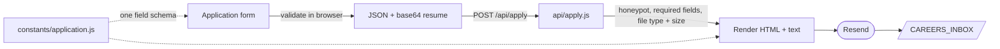

<p align="center">
  
</p>

<h1 align="center">Hollingshead Harbor</h1>

<p align="center">
  <b>Marine transportation: bulk cargo, vessel and barge charter, full-service ports.</b>
</p>
<p align="center">
  The official site for SRM Concrete's marine division and its 13-harbor network.<br />
  Live at <a href="https://hollingsheadharbor.com">hollingsheadharbor.com</a>.
</p>

<p align="center">
  
  
  
  
  
  
</p>

<br />

## Why Hollingshead Harbor

Most applicants fill this out on a phone, standing on a dock, and they will not come back for a second attempt. So the whole employment application sits on one page, checks itself before it submits, and lands in the hiring inbox as a formatted email with the resume attached. The rest of the site covers who the company is, what it runs, and who to call.

**The application, in one page.** Position, contact details, four employers, personal history, and a signed acknowledgment. Checked in the browser, then checked again on the server before anything is sent.

**Content without a CMS.** Job postings and fleet equipment are two JSON files. Adding a boat or a job description is a data edit, not a code change.

<br />

## Stack

| Layer | Technology |
| :--- | :--- |
| UI | React 19 + React Router 7 |
| Build & dev | Vite 7 |
| Styling | Tailwind CSS 3, self-hosted Archivo and Inter, SRM navy and red from the token block |
| Application delivery | Vercel Function (`api/apply.js`) + Resend |
| Content | Static JSON: job postings, fleet equipment |
| Analytics | One tracker tag, appended after the load event so it never sits on the critical path |
| Hosting | Vercel (SPA rewrites in `vercel.json`) |

## Getting started

Node 22 — the version `package.json` pins and CI runs.

```bash
npm install
npm run dev           # Vite dev server
npm run build         # production build to dist/
```

`npm run dev` serves the site but not `api/`. To exercise the application endpoint locally, run `vercel dev` instead, which serves both.

### Environment

Three variables, set in Vercel and required only by `api/apply.js`. Without them the endpoint returns a 500 and the form shows its error state.

| Variable | Holds |
| :--- | :--- |
| `RESEND_API_KEY` | Resend key, send-only scope |
| `CAREERS_INBOX` | Where applications are delivered; comma-separate for more than one recipient |
| `CAREERS_FROM` | Sending address on a Resend-verified domain |

### Scripts

| Script | Does |
| :--- | :--- |
| `npm run dev` | Start the Vite dev server. |
| `npm run build` | Production build to `dist/`. |
| `npm run preview` | Serve the production build locally. |
| `npm run lint` | Lint with ESLint. |
| `npm run format` | Format `src/**` with Prettier. |
| `npm run format:check` | Check formatting without writing. |

## Routes

Every route renders inside one nested `Layout`: a two-tier fixed header with a section panel behind About Us, Careers, and Contact Us; footer; the TaylorURL rail; scroll and hash restoration. Each page declares its own head through `Seo`. Every route is its own chunk, loaded on demand — the home page's filename is written into the document as a `modulepreload` at build time so the landing route is not discovered a round trip late.

| Route | Renders |
| :--- | :--- |
| `/` | Hero, why Hollingshead, harbor network, hiring and contact CTAs |
| `/about` | What the division does, the 1999 founding story, core values, the SRM family |
| `/equipment` | Fleet cards from `equipment.json`, or a specs-on-request panel while it is empty |
| `/careers` | Job postings from `positions.json` and the full employment application |
| `/contact` | The office line and email, the Murfreesboro and San Leon addresses, the states served, and a careers handoff |
| `/privacy-policy` | Privacy policy |
| `/terms` | Terms of use |
| `*` | Not found |

## Architecture



## How it works

- **One schema drives the form and the email.** `constants/application.js` declares the sections and the employer field list once. The form renders from it and the email prints from it, which keeps a field from existing on one side and not the other.
- **Validation runs twice.** The browser blocks submission, lists every problem at the top of the form with a link to the field that owns it, and sends focus to the first one. The endpoint then re-checks the fields it refuses to send without, since anything reaching a public URL can skip the browser entirely.
- **Applicant data is never logged.** Applications carry a Social Security number and a date of birth, so `api/apply.js` logs failure messages only. The payload goes to the outbound email and nowhere else.
- **A hidden honeypot field returns success.** Bots that fill it get a 200 and no email is sent, so a scraper cannot tell rejection from delivery.
- **One hero component.** Every route with a hero band renders `HeroSection`: a photographic backdrop under a navy wash with a red rule beneath it, so pages stay consistent without per-page art direction.
- **A deploy never strands an open tab.** Route chunks carry a content hash, so a tab left open across a release asks for a filename the host no longer has. `lib/chunk-recovery.js` turns that one failure into a single reload per tab rather than an error screen.
- **Sections reveal on scroll.** `useScrollAnimation` wraps `IntersectionObserver`; the `stagger-*` classes in `src/index.css` space the reveals within a group.
- **Every colour comes from one token block.** `src/index.css` holds the primitives, the semantic aliases that name them by purpose, and the light, dark, and gray themes that redefine those aliases. `tailwind.config.js` generates its whole palette from them and names no value of its own. Navy and red are anchored to the SRM brand, with warm "sand" and cool "mist" surface tints and a deep "hull" tone for heroes.

## Project structure

```
hollingsheadharbor-com/
├── api/
│   └── apply.js               Vercel Function: validates and mails an application
├── public/                    Logo, hero background at three widths, operations
│                              photos, self-hosted Archivo and Inter, icons,
│                              robots.txt, sitemap.xml, llms.txt, share card,
│                              web manifest, release.json
└── src/
    ├── App.jsx                Routes wrapped in the shared Layout
    ├── main.jsx               Browser entry
    ├── index.css              Design tokens, the three themes, Tailwind layers
    ├── components/            Layout, Header, Footer, MobileRail, HeroSection, Breadcrumbs,
    │                          ApplicationForm, FormControls, ArtPlate, Icon, Seo, …
    ├── pages/                 Home, About, Equipment, Careers, Contact, PrivacyPolicy, Terms, NotFound
    ├── data/                  positions.json · equipment.json
    ├── constants/             application.js · navigation.js · seo.js · urls.js
    ├── hooks/                 useScrollAnimation.js · useScrolledPast.js · useClickSpark.js
    └── lib/                   chunk-recovery.js
```

The footer rail is `@taylorurl/split-rail`, a dependency rather than a file here.

## License

Copyright (c) 2026 Trenton Taylor. All rights reserved. See [LICENSE.md](LICENSE.md).

<br />

<p align="center">
  <sub>Built by <a href="https://taylorurl.com">TaylorURL</a>. Custom sites for local businesses.</sub>
</p>
